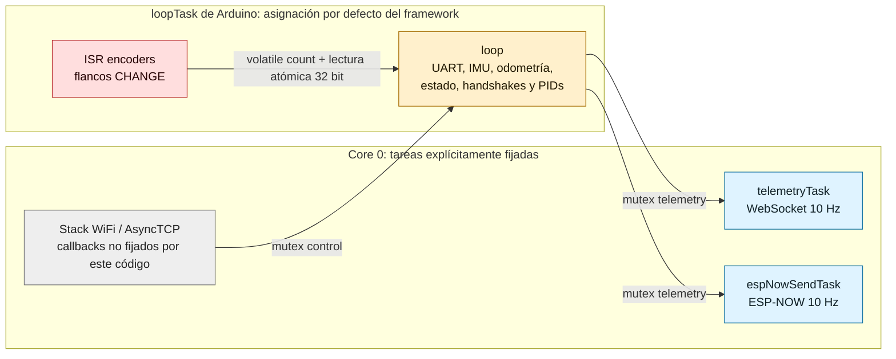
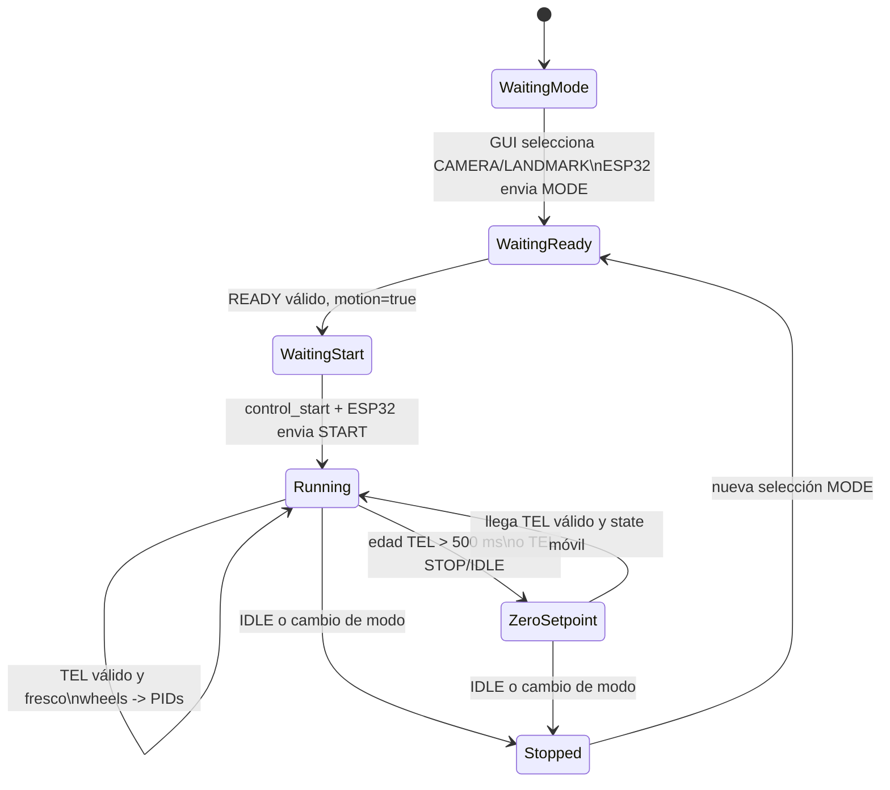
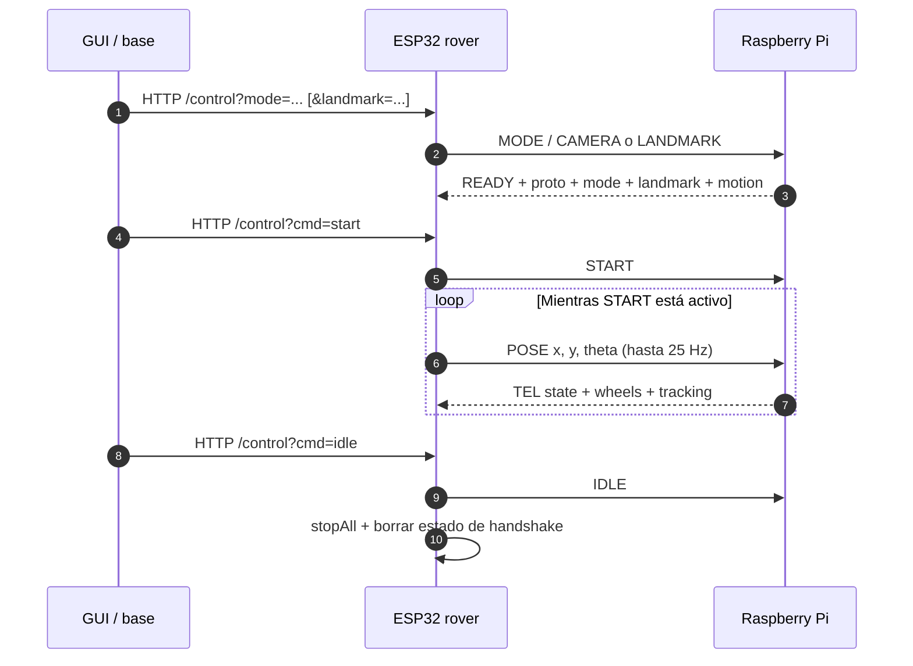
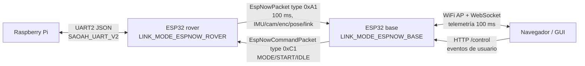

# Documentación técnica del firmware ESP32 - Omnirover

Este documento describe el firmware compilable actual. La fuente de verdad para valores y comportamiento es [src/main.cpp](src/main.cpp) junto con los módulos `.h` y `.cpp`; los comentarios históricos de algunos `README.md` no siempre coinciden con los valores actuales del código. Los cuatro índices de motor son siempre: `0 = FL`, `1 = FR`, `2 = BL`, `3 = BR`.

## 1. Arquitectura Dual-Core y manejo de tareas (FreeRTOS)

**Modos de compilación.** `ROVER_LINK_MODE`, definido en [include/net_config.h](include/net_config.h), produce tres configuraciones distintas:

| Modo | Tareas ejecutadas | Sensores/PIDs | GUI |
|---|---|---:|---:|
| `LINK_MODE_LOCAL` (`0`) | `loop()`, `telemetryTask` | Sí | WiFi AP + WebSocket en la misma ESP32 |
| `LINK_MODE_ESPNOW_ROVER` (`1`) | `loop()`, `espNowSendTask` | Sí | No; transmite telemetría a la base |
| `LINK_MODE_ESPNOW_BASE` (`2`) | `telemetryTask`, `loop()` mínimo | No | Recibe ESP-NOW y hospeda la GUI |

En `setup()` de [src/main.cpp](src/main.cpp), la placa base solo ejecuta `webServer_init()` y `espNow_init()`. La placa rover o local inicializa, según modo, telemetría/control, ESP-NOW, UART con la Raspberry Pi mediante `cam_init()`, BNO mediante `init_IMU()`, motores/encoders mediante `motors.init()` y una parada segura de 2 s mediante `waitForSafeStart()`.



**Core 0.** Hay dos tareas creadas explícitamente:

- `telemetryTask()` en [src/web_server/web_server.cpp](src/web_server/web_server.cpp): creada con `xTaskCreatePinnedToCore(..., "telemetry", 4096, ..., 1, ..., 0)`. Cada 100 ms obtiene un snapshot, serializa a JSON y llama `ws.textAll()`. Solo encola un frame si `ws.availableForWriteAll()` lo permite, y ejecuta `ws.cleanupClients()` para retirar clientes. Esto evita acumular telemetría obsoleta cuando un navegador tiene su cola de TX llena.
- `espNowSendTask()` en [src/espnow_link/espnow_link.cpp](src/espnow_link/espnow_link.cpp): existe solo en `LINK_MODE_ESPNOW_ROVER` y se crea con `xTaskCreatePinnedToCore(..., "espnow_tx", 4096, ..., 1, ..., 0)`. Cada 100 ms toma un `RoverTelemetry`, construye un `EspNowPacket` y llama `esp_now_send()`.

Ambas tareas tienen prioridad `1`, stack de 4096 bytes y afinidad explícita al Core 0. Los callbacks HTTP/AsyncTCP y los callbacks ESP-NOW pertenecen al contexto que proporcionan sus librerías; este firmware no los fija individualmente a un núcleo mediante una tarea propia.

**Core 1 / lazo del rover.** `setup()` y `loop()` de Arduino corren en la `loopTask` que crea el framework. El código de este proyecto no usa `xTaskCreatePinnedToCore()` para crear un lazo de control, por lo que la afinidad efectiva depende de la configuración de Arduino-ESP32 y no de una asignación establecida en estos archivos. En la configuración dual-core habitual esa `loopTask` corre en Core 1, pero el punto importante para la demostración es que no hay una garantía de afinidad escrita aquí.

El recorrido de `loop()` en modo rover/local es:

1. `cam_poll()` drena bytes UART sin esperar.
2. `pollIMU()` llama `update_IMU()` y publica `telemetry_setIMU(get_IMU_Data())`.
3. `motors.updateEncoderTelemetry()` calcula RPM, integra odometría y publica encoders/pose.
4. `control_getState()` obtiene una copia protegida del modo, landmark y estado `running`.
5. Si hay una revisión nueva de modo o idle, detiene motores y envía `MODE`/`IDLE` a la Pi.
6. Si está `running`, completa `START`, copia los cuatro setpoints UART, envía `POSE` a un máximo de 25 Hz y alimenta los cuatro PID.
7. `telemetry_setPiLink(cam_getLinkStatus())` publica el estado del enlace.
8. `motors.updateSpeedControl()` ejecuta los PID solo cuando han pasado al menos 20 ms.
9. `delay(1)` cede ejecución al scheduler.

Por tanto, el lazo no es un RTOS de muestreo estricto: su base es aproximadamente 1 ms cuando la carga lo permite, pero el tiempo real entre iteraciones es variable. La determinación del PID y de la odometría usa `dt` medido con `millis()`, no supone una iteración exacta de 1 ms. En la placa base, `loop()` solo ejecuta `delay(10)`.

**Protección entre núcleos y callbacks.** Las estructuras compartidas están separadas por mecanismo:

| Dato compartido | Productor/consumidor | Protección real |
|---|---|---|
| `g_telemetry` | `loop()`, callbacks UART, base ESP-NOW, tareas de envío | `g_mutex` de `telemetry.cpp`, creado con `xSemaphoreCreateMutex()`; cada setter toma el mutex con `portMAX_DELAY`, modifica un campo y lo libera |
| `g_state` de control | HTTP/ESP-NOW versus `loop()` | `g_mutex` de `control.cpp`; `control_getState()` devuelve una copia estructurada protegida |
| `encoderCount[]`, `encoderPrevState[]` | ISR versus `loop()` | `volatile`; en ESP32, `long` de 32 bits alineado permite una lectura/escritura indivisible, aunque no se usa critical section ni se congela una imagen multi-encoder simultánea |
| Estado UART `ready`, `started`, `wheelSpeeds[]` | `cam_poll()` y lógica principal | Solo se accede desde `loop()`; no requiere mutex entre núcleos |
| `g_pose`, `current_data`, `yawZeroed` | `loop()` y botones locales HTTP | Acceso de los callbacks `resetPose`/`resetYaw` sin mutex propio; es el único punto relevante de carrera funcional en modo local/base |

Los mutexes se usan en secciones cortas y no se anidan entre sí. No existe en este código una secuencia que tome primero `control.cpp::g_mutex` y después `telemetry.cpp::g_mutex` o viceversa, por lo que no aparece el ciclo de espera clásico de un deadlock. Sí pueden esperar indefinidamente (`portMAX_DELAY`) si una tarea se aborta mientras retiene el mutex; por eso es esencial que los setters no hagan I/O ni esperas mientras lo poseen. `telemetry_toJson()` primero obtiene y libera el snapshot mediante `telemetry_get()`, y solo después hace la serialización costosa.

Los envíos WebSocket y ESP-NOW no bloquean el PID de velocidad: corren como tareas separadas en Core 0. La comunicación UART tampoco usa una tarea ni una cola software propia; usa el buffer RX de `HardwareSerial(2)` y `cam_poll()` drena lo disponible con `while (piSerial.available() > 0)`.

Hay dos límites a la coherencia “sin carreras” que conviene conocer para la demostración:

- La recepción ESP-NOW llama varios setters de telemetría por separado. La memoria individual está protegida, pero un WebSocket puede tomar un snapshot entre dos setters y observar temporalmente una mezcla del paquete anterior y del nuevo.
- `/control?cmd=resetPose` llama `odometry_reset()` desde el callback async; `/control?cmd=resetYaw` llama `imu_zeroYaw()`. En `LINK_MODE_LOCAL`, esos callbacks pueden coincidir con `odometry_update()` o `update_IMU()`. Son operaciones simples, pero no están protegidas por un mutex.

## 2. Adquisición de sensores (BNO + Encoders) y Odometría discreta

**BNO08x: bus, reports y ciclo de lectura.** [src/imu/imu.cpp](src/imu/imu.cpp) crea `Adafruit_BNO08x bno08x(-1)` y un `TwoWire I2C_IMU` en el bus 0. `init_IMU()` inicia I2C en `I2C_SDA_PIN = 21`, `I2C_SCL_PIN = 22` a 400 kHz y usa `BNO08x_I2CADDR_DEFAULT`, correspondiente al montaje I2C documentado en [include/pins.h](include/pins.h). `enable_reports()` solicita tres reports a 100 Hz:

- `SH2_ACCELEROMETER`: aceleración en $\mathrm{m/s^2}$, incluida la gravedad.
- `SH2_GYROSCOPE_CALIBRATED`: velocidad angular en $\mathrm{rad/s}$, ya con la calibración interna del BNO para el giroscopio.
- `SH2_GAME_ROTATION_VECTOR`: cuaternión fusionado de orientación, sin referencia de magnetómetro.

`update_IMU()` comprueba `bno08x.wasReset()`. Si hubo reset, vuelve a habilitar los reports y fuerza una nueva captura del cero angular. Después drena eventos con `while (bno08x.getSensorEvent(&event))`; por eso la ESP32 no espera activamente a 100 Hz: consulta eventos cuando `pollIMU()` se ejecuta desde `loop()`.

La aceleración usa una EMA discreta con $\alpha=0.2$:

$$
a_f[k] = a_f[k-1] + 0.2\left(a[k]-a_f[k-1]\right).
$$

La primera muestra inicializa directamente `accelX`, `accelY` y `accelZ`; las componentes `gyroX/Y/Z` se copian sin filtrar. `IMU_Data::temp` existe y se publica por telemetría, pero no se actualiza porque no se habilita un report de temperatura. Tampoco existe una rutina de calibración completa del BNO ni un estado de calidad de calibración expuesto: “calibración inicial” se refiere aquí al cero relativo de yaw, no a calibrar offsets del acelerómetro/giroscopio en firmware.

**Extracción, cero y wrap-around de `theta`.** `quaternionToYawDeg(qr, qi, qj, qk)` extrae yaw del cuaternión y niega el resultado de `atan2f()` para adoptar la convención del rover, donde cero apunta hacia delante y un ángulo positivo es giro horario:

$$
\theta_{raw} = -\frac{180}{\pi}
\operatorname{atan2}\left(2(q_iq_j+q_kq_r),\ q_i^2-q_j^2-q_k^2+q_r^2\right).
$$

Como `SH2_GAME_ROTATION_VECTOR` no aporta una referencia absoluta, el primer evento después de boot o reset se captura como `yawOffsetDeg`:

$$
\theta[k] = \operatorname{wrap}_{(-180,180]}(\theta_{raw}[k]-\theta_{offset}).
$$

`wrapYawDeg()` resta 360° mientras el resultado exceda $180^\circ$ y suma 360° mientras sea menor o igual a $-180^\circ$. `imu_zeroYaw()` pone `yawZeroed = false`, así que la siguiente muestra redefine ese rumbo como cero. El dato `get_IMU_Data().yaw` está en grados; `main.cpp` lo convierte con `DEG_TO_RAD` antes de enviarlo como `theta` a la Pi por UART.

**Cuatro encoders en cuadratura.** [src/motors/motors.cpp](src/motors/motors.cpp) adjunta una interrupción `CHANGE` a A y B de cada encoder. `onEncoderChange()` reconstruye el estado de dos bits, calcula `(encoderPrevState << 2) | state` y suma el incremento `QUAD_TABLE[transition]`, que vale $-1$, $0$ o $+1$. Así se decodifica dirección y se ignoran transiciones inválidas sin depender de la velocidad de `loop()`.

| Índice interno | Rueda física | Encoder A/B | CPR `ENCODER_COUNTS_PER_REV` | `ENCODER_DIR` | `MOTOR_CMD_DIR` |
|---:|---|---:|---:|---:|---:|
| M0 | FL | 13/14 | 1047 | $-1$ | $+1$ |
| M1 | FR | 36/39 | 2046 | $+1$ | $+1$ |
| M2 | BL | 34/35 | 1028 | $-1$ | $+1$ |
| M3 | BR | 4/5 | 1000 | $+1$ | $-1$ |

`ENCODER_DIR` normaliza el signo de cuenta para que positivo signifique movimiento hacia delante en la convención de rueda. `MOTOR_CMD_DIR` normaliza el signo de PWM; M3 tiene el driver conectado invertido. Las entradas de GPIO 34/35/36/39 son solo de entrada y requieren pull-ups externos a 3.3 V.

Si $C_m[k]$ es el conteo crudo, para un intervalo $\Delta t$ medido con `millis()`:

$$
\Delta N_m[k] = \left(C_m[k]-C_m[k-1]\right)D_m,
$$

$$
RPM_m[k] = \frac{\Delta N_m[k]}{CPR_m}\frac{60000}{\Delta t_{ms}},
$$

$$
\omega_m[k] = \frac{\Delta N_m[k]}{CPR_m}\frac{2\pi}{\Delta t_s}.
$$

Aquí $D_m$ es `ENCODER_DIR[m]`. `updateSpeedControl()` usa esta última ecuación cada aproximadamente 20 ms y luego filtra la velocidad para cerrar el PID. `updateEncoderTelemetry()` usa la ecuación RPM con el `elapsedMs` real y la versión sin filtro para odometría, porque no debe introducir retardo del pasa-bajas en la integración de pose.

**Odometría mecanum discreta.** [src/odometry/odometry.cpp](src/odometry/odometry.cpp) recibe `wheelRpm[4]`, `yawDeg` y `elapsedMs`. Convierte cada rueda a velocidad lineal con radio `WHEEL_RADIUS_M = 0.04 m`:

$$
v_i[k] = \frac{RPM_i[k]}{60}2\pi R_w,\qquad R_w=0.04\ \mathrm{m}.
$$

Con el orden FL, FR, BL, BR, la cinemática directa del cuerpo es:

$$
v_{x,body} = \frac{v_0+v_1+v_2+v_3}{4},
$$

$$
v_{y,body} = \frac{v_0-v_1-v_2+v_3}{4},
$$

donde $v_x$ es adelante y $v_y>0$ es lateral hacia la derecha. El giro de las velocidades al marco global sigue la convención de brújula del firmware, $	heta=0$ hacia $+Y$ y $	heta>0$ horario:

$$
\dot x_W = v_{x,body}\sin\theta + v_{y,body}\cos\theta,
$$

$$
\dot y_W = v_{x,body}\cos\theta - v_{y,body}\sin\theta.
$$

La integración ejecutada por `odometry_update()` es Euler hacia adelante:

$$
x[k] = x[k-1] + \dot x_W[k]\Delta t_k,
$$

$$
y[k] = y[k-1] + \dot y_W[k]\Delta t_k.
$$

La pose global de demostración es por tanto $(x, y, \theta)$, pero el struct `OdometryPose` solo almacena `x` e `y`. El tercer componente se toma directamente de la BNO y no se integra desde encoders:

$$
\theta[k] = \text{wrap}(\text{BNO yaw}[k]-\text{yawOffsetDeg}).
$$

`HALF_WHEELBASE_M = 0.08` y `HALF_TRACK_M = 0.105` están declaradas para una eventual estimación de giro por ruedas, pero no participan en la odometría actual. La estimación carece de compensación de patinaje, especialmente lateral en ruedas mecanum, y acumula deriva porque no hay una corrección absoluta de posición.

`motors.updateEncoderTelemetry()` se llama en cada `loop()`. Por eso su `dt` no es el `Ts = 20 ms` del PID y puede ser cercano a 1 ms, sujeto a carga de tareas y callbacks. `odometry_init()` se ejecuta dentro de `motors.init()`; `odometry_reset()` reinicia `g_pose` al origen.

## 3. Lógica de Control y PIDs discretos de los 4 motores

**Cuatro PID desacoplados.** La clase `PID` de [src/pid/pid.cpp](src/pid/pid.cpp) se instancia cuatro veces en el constructor de `MotorController`. Cada lazo regula la velocidad angular filtrada de una rueda con `setpoint` y `measurement` en $\mathrm{rad/s}$.

Con $T_s=\Delta t_k$ medido por tick, la ecuación implementada es:

$$
e[k] = r[k]-y_f[k],
$$

$$
I[k] = \operatorname{sat}_{[-7.2,7.2]}\left(I[k-1]+K_i e[k]T_s\right),
$$

$$
D_m[k] = \begin{cases}
0, & \text{primera ejecución}\\
\dfrac{y_f[k]-y_f[k-1]}{T_s}, & \text{resto}
\end{cases},
$$

$$
u[k] = \operatorname{sat}_{[-7.2,7.2]}\left(K_p e[k]+I[k]-K_dD_m[k]\right).
$$

La salida se interpreta como una consigna equivalente en $\mathrm{rad/s}$ y se convierte a PWM de 8 bits:

$$
PWM_{cmd,m}[k] = \operatorname{round}\left(\frac{u_m[k]}{7.2}255\right)\,MOTOR\_CMD\_DIR_m.
$$

`setMotorSpeed()` vuelve a saturar a $[-255,255]$, escribe cero en el canal opuesto y usa los ocho canales LEDC a 20 kHz. Un valor de salida cero apaga ambos canales, condición documentada como coast/stop.

`PID::reset()` borra `integral_`, `prevMeasurement_` y `firstRun_`. `stopMotor()` lo invoca después de desactivar `pidActive_`, para que un arranque posterior no herede integral acumulado. El anti-windup es por recorte directo del integrador al mismo rango que la salida; no hay back-calculation, conditional integration ni reset por cambio de signo.

**Filtro de medición.** La velocidad cruda de 20 ms se pasa por una EMA con constante `SPEED_FILTER_TAU_S = 0.035 s`:

$$
\alpha = \frac{T_s}{0.035+T_s},
$$

$$
y_f[k] = y_f[k-1]+\alpha\left(y_{raw}[k]-y_f[k-1]\right).
$$

Ese filtro corre también cuando el PID está desactivado, para que telemetría y próxima activación no observen un valor viejo. La derivada se calcula sobre la medición, no sobre el error; esto evita un “derivative kick” cuando cambia de repente `targetRadS_`.

**Periodo real.** `PID_PERIOD_MS = 20`, es decir, $f_s=50\ \mathrm{Hz}$ nominales. `updateSpeedControl()` retorna mientras `elapsedMs < 20`; cuando continúa, usa el `elapsedMs` real y actualiza `lastPidMs_`. Un tick puede ser mayor que 20 ms bajo carga, por lo que este es un lazo de 50 Hz máximo, no una tarea FreeRTOS con periodo absoluto fijo.

**Saturación y zona muerta.** Sí hay dos saturaciones explícitas: la consigna de `setWheelSpeed()` se limita a $\pm MAX\_WHEEL\_RAD\_S$ y la salida PWM a $\pm255$. No existe una constante, umbral o compensación de zona muerta PWM. La conversión a entero redondeado implica una resolución cuántica aproximada de $7.2/255\ \mathrm{rad/s}$ por cuenta de PWM, pero no es una dead-zone intencional. La fricción estática debe ser vencida por la integral y por la autoridad proporcional; no se añade un mínimo de duty. Las funciones `setMotorSpeedRamped()`/`update()` sí implementan una rampa de 300 ms de cero a duty máximo, pero `main.cpp` actual no llama `motors.update()` ni usa esa API, así que el camino PID vigente puede cambiar de consigna sin la rampa.

**Setpoints desde Raspberry Pi.** El arreglo recibido llega como `TEL.wheels` en orden `[w0,w1,w2,w3]`. `processTel()` valida que sea un arreglo de al menos cuatro valores, que cada elemento sea numérico finito y que el estado permita movimiento. `cam_copyWheelSpeeds()` solo copia el contenido si `cam_wheelsFresh()` devuelve verdadero; si no, entrega cuatro ceros. En `main.cpp`:

```cpp
cam_copyWheelSpeeds(wheelSpeeds);
for (uint8_t motor = 0; motor < NUM_MOTORS; motor++) {
    motors.setWheelSpeed(motor, wheelSpeeds[motor]);
}
```

`setWheelSpeed()` activa ese PID, reinicia sus condiciones si estaba inactivo y recorta la referencia a `MAX_WHEEL_RAD_S`. No hay validación UART de un máximo físico antes del clamp: cualquier número finito es aceptado por `cam.cpp` y limitado después por `motors.cpp`.



**Watchdog y parada de seguridad.** `cam_wheelsFresh()` exige simultáneamente:

- `started == true`;
- que se haya recibido al menos un `TEL`;
- `telAllowsMotion == true`;
- `millis() - lastTelMs <= TEL_TIMEOUT_MS`, con `TEL_TIMEOUT_MS = 500`.

Cuando `processTel()` ve `state == "STOP"` o `state == "IDLE"`, pone `telAllowsMotion = false`, borra `wheelSpeeds[]` y registra ese estado en `lastIssue`. Lo mismo ocurre con `wheels` ausente, tipo no numérico o valor no finito. Después de 500 ms sin TEL, `cam_wheelsFresh()` pasa a falso aunque `started` siga siendo verdadero. La siguiente copia entrega `[0,0,0,0]`.

Este watchdog protege el setpoint, pero su implementación actual no llama directamente `motors.stopAll()` por timeout. Al superar 500 ms, los cuatro PID siguen activos con referencia cero y deben llevar PWM hacia cero según su dinámica. La parada inmediata y desactivación/reset de PID ocurre en estos casos distintos:

- `MODE` nuevo: cambio de `modeRevision` en `main.cpp` -> `motors.stopAll()`;
- `IDLE`: cambio de `idleRevision` -> `motors.stopAll()` y envío de `IDLE` a la Pi;
- `controlState.running == false`: `motors.stopAll()` si el rover estaba corriendo o `cam_started()`;
- `START` enviado pero sin `TEL`: no hay consignas en movimiento y se copian ceros.

## 4. Comunicación UART con la Raspberry Pi (`SAOAH_UART_V2`)

**Capa física.** [src/cam/cam.cpp](src/cam/cam.cpp) abre `HardwareSerial piSerial(2)` con 8N1 en 115200 baud, `PI_UART_RX_PIN = 16` y `PI_UART_TX_PIN = 17`. La Pi transmite desde su GPIO14 hacia RX2 y recibe en GPIO15 desde TX2; ambos lados son lógica de 3.3 V y requieren GND común. `piSerial.setRxBufferSize(1024)` amplía el buffer hardware. `Serial` por USB también se inicia a 115200 para mensajes de boot, pero no transporta el protocolo Pi, que usa exclusivamente UART2.

**Parser no bloqueante.** `cam_poll()` recorre `while (piSerial.available() > 0)`, toma un byte y sale en cuanto la FIFO queda vacía. Acumula caracteres en `String lineBuf`; `\n` o `\r` cierran una línea y llaman `processLine()`. No usa `readStringUntil()`, timeouts UART ni esperas activas.

- `PI_LINE_MAX = 512`: si la línea supera el máximo, se descarta hasta el siguiente delimitador.
- `PARTIAL_FLUSH_MS = 250`: un fragmento que no llegó a delimitador se borra después de 250 ms sin nuevo byte.
- `ArduinoJson::deserializeJson()` valida JSON antes de mirar `type`; un error deja `lastIssue = "JSON_ERROR"`.
- Los tipos desconocidos no ejecutan comandos.

El diseño protege RAM y evita que una línea corrupta desplace el lazo de control, aunque el uso de `String` y la reserva se realizan antes de entrar al flujo de movimiento.



**Mensajes ESP32 -> Pi.** `sendDocument()` usa `serializeJson(doc, piSerial)` y agrega un único `\n`.

| Función | JSON emitido | Condición |
|---|---|---|
| `cam_requestMode()` | `{"type":"MODE","mode":"CAMERA"}` | Selección de cámara |
| `cam_requestMode()` | `{"type":"MODE","mode":"LANDMARK","landmark":"TOP_RIGHT"}` | Selección landmark; los otros cuatro se envían con el mismo esquema |
| `cam_sendStart()` | `{"type":"START"}` | Existe `READY` válido y aún no estaba `started` |
| `cam_sendPose()` | `{"type":"POSE","x":...,"y":...,"theta":...}` | Solo con `started`; `POSE_SEND_PERIOD_MS = 40` limita a máximo 25 Hz |
| `cam_sendIdle()` | `{"type":"IDLE"}` | Revisión de idle o comando del usuario |

`cam_sendPose()` usa `odometry_getPose()` para `x/y` en metros y `get_IMU_Data().yaw * DEG_TO_RAD` para `theta` en radianes. El envío de `POSE` es la única transmisión periódica del protocolo; `MODE`, `START` e `IDLE` son eventos.

**Mensajes Pi -> ESP32: `READY`.** `processLine()` acepta la mano de obra solo si:

1. `type == "READY"`;
2. `proto == "SAOAH_UART_V2"`;
3. `mode` es exactamente `CAMERA` o `LANDMARK`;
4. `motion == true`;
5. el modo coincide con `requestedMode`;
6. en `LANDMARK`, el landmark parseado coincide con `requestedLandmark`.

`parseLandmark()` acepta `TOP_RIGHT`, `TOP_LEFT`, `DOWN_RIGHT`, `DOWN_LEFT` y `CENTER`. Si falla cualquier requisito, `ready` queda falso y `lastIssue` pasa a `READY_REJECTED`. No se acepta un protocolo legacy por tolerancia de versión.

**Mensajes Pi -> ESP32: `TEL`.** `processTel()` consume:

- `state`: se copia en `lastTelState`; cualquier valor distinto de `STOP` e `IDLE` habilita movimiento mientras el paquete de ruedas sea válido;
- `wheels`: arreglo de cuatro o más valores numéricos finitos; los primeros cuatro alimentan `wheelSpeeds[]`;
- `tracking`: publica `CamData::valid`;
- `tag_x`, `tag_y`: publican `cam.x` y `cam.y`;
- `width_px`: se redondea y publica `cam.width`;
- `target`, `arrived`: publican destino y condición de llegada.

`CamData::height` y `CamData::id` existen en la estructura de telemetría, pero esta versión del parser TEL no los llena, por lo que permanecen en cero. Los errores se exponen en `lastIssue`: `WHEELS_MISSING`, `WHEELS_TYPE`, `WHEELS_NONFINITE` o `WHEELS_OK`.

## 5. Telemetría y GUI por ESP-NOW

**Ruta de datos completa.** [src/telemetry/telemetry.cpp](src/telemetry/telemetry.cpp) mantiene un único `RoverTelemetry` con IMU, cámara, cuatro `EncoderData`, pose y `PiLinkStatus`. Los productores se comunican con él mediante setters protegidos. `telemetry_toJson()` toma un snapshot y genera los campos `t`, `imu`, `cam`, `enc`, `pose` y `link`; `link` incluye handshake, edad de TEL, issue y el arreglo `wheels`.

En `LINK_MODE_LOCAL`, el mismo `RoverTelemetry` alimenta directamente el WebSocket de la GUI. En modo remoto se usa la topología bidireccional siguiente:



`espNowSendTask()` toma el snapshot en Core 0, copia los datos a `EspNowPacket` y transmite cada 100 ms. `static_assert(sizeof(EspNowPacket) <= 250)` comprueba en compilación el límite del payload. La pareja usa actualmente `ESPNOW_PEER_MAC = FF:FF:FF:FF:FF:FF`, es decir, broadcast, con cifrado desactivado; para una instalación cerrada el valor se debe sustituir por MAC unicast real.

**Recepción de telemetría en la base.** `onDataRecv()` comprueba que la longitud sea exactamente `sizeof(EspNowPacket)` y que `packet.type == ESPNOW_TELEMETRY_TYPE (0xA1)`. Luego publica uptime, IMU, cámara, pose, estado UART y los cuatro encoders. El WebSocket `telemetryTask` no espera a que la placa base lea sensores: solo reenvía el snapshot compartido cada 100 ms. La transmisión y serialización ocurren en Core 0, separadas del camino de PID de la placa rover.

**Comandos de la GUI.** [src/web_server/web_dashboard_html.h](src/web_server/web_dashboard_html.h) usa eventos HTTP, no mensajes WebSocket de entrada: `onWsEvent()` está vacío y todo control llega por `/control`.

- `modeSelect` ofrece `CAMERA` y `LANDMARK`.
- Cuando se selecciona `LANDMARK`, `landmarkSelect` ofrece exactamente `TOP_RIGHT`, `TOP_LEFT`, `DOWN_RIGHT`, `DOWN_LEFT` y `CENTER`.
- START ejecuta primero `sendModeSelection()` y luego `GET /control?cmd=start`.
- IDLE ejecuta `GET /control?cmd=idle`.

La ruta HTTP de [src/web_server/web_server.cpp](src/web_server/web_server.cpp) llama `control_selectMode()`, `control_start()` o `control_idle()`. En una placa base, además llama `espNow_sendControl()`; en local el estado se aplica sobre la misma placa y la función ESP-NOW queda compilada como no-op.

`EspNowCommandPacket` usa `type = 0xC1`, `command`, `mode` y `landmark`. La recepción en rover interpreta:

| `command` | Efecto en control local |
|---|---|
| `ESPNOW_CONTROL_MODE` | `control_selectMode(packet.mode, packet.landmark)`; incrementa `modeRevision` y deja `running = false` |
| `ESPNOW_CONTROL_START` | `control_start()`; pone `running = true` |
| `ESPNOW_CONTROL_IDLE` | `control_idle()`; pone `running = false` e incrementa `idleRevision` |

`IDLE` también representa la semántica de stop remoto, y no existe un comando ESP-NOW separado `STOP`. Los botones `resetPose` y `resetYaw` no tienen equivalente en `EspNowControlCommand`; en la placa base afectan el estado local y no ordenan un reset físico de la odometría o IMU del rover.

**No bloqueo y límites de entrega.** El emisor ESP-NOW no bloquea el PID porque ejecuta `esp_now_send()` en `espNowSendTask()` de Core 0 y solo comparte un snapshot protegido. El WebSocket igualmente omite el frame cuando las colas cliente están ocupadas. No hay callback de envío ESP-NOW que confirme recepción, ACK de aplicación, número de secuencia ni retransmisión. Un clic de START/MODE/IDLE se envía cuando ocurre el HTTP; la siguiente telemetría puede mostrar si el rover recibió o procesó el estado, pero el enlace no garantiza entrega por sí solo.

`LINK_MODE_LOCAL` no activa radio ESP-NOW, y [src/espnow_link/espnow_link.cpp](src/espnow_link/espnow_link.cpp) compila funciones vacías. `LINK_MODE_ESPNOW_BASE` no inicializa IMU, UART Pi, motores ni encoders, solo WiFi AP/STA, servidor web y recepción ESP-NOW.

## 6. Tabla resumen de frecuencias (Hz) de cada tarea y valores actuales de sintonización de los PIDs

**Frecuencias vigentes.** Estas son las frecuencias nominales o límites que surgen de las constantes actuales, no una garantía hard real-time.

| Actividad/tarea | Frecuencia nominal | Disparador | Observaciones |
|---|---:|---|---|
| `loop()` rover/local | aproximadamente 1000 Hz | `delay(1)` | Dependiente de carga; no usa periodo absoluto. El loop base corre aproximadamente 100 Hz por `delay(10)`. |
| `cam_poll()` UART | se llama en cada `loop()` | bytes disponibles | RX no bloqueante y no espera delimitador dentro de una llamada. |
| Reports BNO | 100 Hz | `enableReport(..., 10000)` | Acelerómetro, gyro calibrado y game rotation vector solicitan reporte cada 10 ms. |
| `update_IMU()` / `pollIMU()` | se intenta en cada `loop()` | cola de eventos BNO | La ESP32 drena eventos, pero la fuente de eventos es de 100 Hz. |
| ISR encoders | variable, por flanco | 8 interrupciones `CHANGE` | A mayor RPM, mayor frecuencia; no es una tarea periódica. |
| PID `updateSpeedControl()` | máximo 50 Hz | `PID_PERIOD_MS = 20` | Usa `elapsedMs` real; puede saltar o correr más lento bajo carga. |
| Filtro de velocidad | máximo 50 Hz | mismo tick PID | $\tau=0.035\ \mathrm{s}$, $\alpha=dt/(\tau+dt)$. |
| `updateEncoderTelemetry()` + odometría | cada `loop()` | `elapsedMs` variable | Usa RPM de conteos sin filtro; no está fijada a 100 Hz ni 50 Hz. |
| `POSE` UART | máximo 25 Hz | `POSE_SEND_PERIOD_MS = 40` | Solo después de `START`. |
| `TEL` UART de entrada | frecuencia externa | llegada desde Pi | El intervalo entre mensajes válidos debe permanecer en 500 ms o menos, equivalente a una tasa mínima aproximada de 2 mensajes/s. |
| Watchdog TEL | `500 ms` de timeout | comparación con `lastTelMs` | Validez incluye `age <= 500 ms`; se vuelve stale cuando la edad es mayor. |
| `telemetryTask` WebSocket | 10 Hz | 100 ms `vTaskDelay` | Core 0; salta envío si el cliente no tiene buffer disponible. |
| `espNowSendTask` telemetría | 10 Hz | 100 ms `vTaskDelay` | Core 0, solo modo rover. |
| Cleanup WebSocket | 10 Hz | mismo `telemetryTask` | Descarta clientes desconectados. |
| PWM LEDC | 20 kHz | hardware LEDC | Resolución 8 bits, rango 0-255 por canal. |
| I2C BNO | 400 kHz de bus | hardware I2C | No confundir velocidad de bus con la tasa de 100 Hz de los reports. |
| `waitForSafeStart()` | evento de boot, 2 s | `SAFE_START_DELAY_MS` | Mantiene motores parados antes de aceptar movimiento. |

**Valores de PID que compilan actualmente.** La tabla toma `PID_KP`, `PID_KI`, `PID_KD`, `ENCODER_COUNTS_PER_REV`, `ENCODER_DIR`, `MOTOR_CMD_DIR` y el límite de [src/motors/motors.h](src/motors/motors.h) como fuente de verdad.

| Motor | Rueda | RPM nominal datasheet | CPR | `ENCODER_DIR` | `MOTOR_CMD_DIR` | $K_p$ | $K_i$ | $K_d$ |
|---:|---|---:|---:|---:|---:|---:|---:|---:|
| M0 | FL | 150 | 1047 | $-1$ | $+1$ | 0.22 | 3.0 | 0.005 |
| M1 | FR | 140 | 2046 | $+1$ | $+1$ | 0.18 | 3.0 | 0.005 |
| M2 | BL | 150 | 1028 | $-1$ | $+1$ | 0.25 | 3.0 | 0.005 |
| M3 | BR | 150 | 1000 | $+1$ | $-1$ | 0.25 | 3.0 | 0.005 |

Parámetros comunes:

| Variable/constante | Valor actual | Uso |
|---|---:|---|
| `PID_PERIOD_MS` | 20 ms | Periodo mínimo del PID, $T_s\approx0.020\ \mathrm{s}$ |
| `SPEED_FILTER_TAU_S` | 0.035 s | Pasa-bajas de primer orden aplicado a medición y telemetría de RPM |
| `PID_OUTPUT_FULL_RAD_S` | 7.2 rad/s | Salida que equivale a PWM 255; también rango de integrador/salida PID |
| `MAX_WHEEL_RPM` | 75 RPM | Cap actual de setpoint en `setWheelSpeed()` |
| `MAX_WHEEL_RAD_S` | $75\cdot 2\pi/60=7.854$ rad/s | Cap calculado a partir de `MAX_WHEEL_RPM` |
| `PWM_FREQ` | 20 kHz | Frecuencia LEDC ultrasónica |
| `PWM_RES` | 8 bits | Resolución y saturación 0-255 |
| `RAMP_TIME_MS` | 300 ms | Rampa disponible, no usada por `main.cpp` actual |

Hay textos históricos inconsistentes dentro del proyecto: algunos comentarios y README todavía dicen que el cap es 80 RPM o muestran $K_p=0$. Para la demostración, el valor compilable vigente es `MAX_WHEEL_RPM = 75` y los $K_p$ anteriores. También se debe observar que el comentario de `MAX_WHEEL_RAD_S` en `motors.h` conserva un valor aproximado antiguo de 8.38 rad/s; la expresión del código con 75 RPM produce 7.854 rad/s.